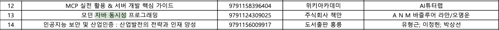

On August 25, the Korea Publication Industry Promotion Agency (KPIPA) announced the 2026 Sejong Books selections for the academic category. The Korean edition of *Modern Concurrency in Java* is on the list of 345 titles.

OnlyBook (책만) published the book in Korea on February 27 as *모던 자바 동시성 프로그래밍*. Sejong Books considers first Korean editions published between May 2025 and the end of February 2026, so it made the window by a day.

<figure>
  
  <figcaption>The book on KPIPA's published list of selected academic titles (row 13).</figcaption>
</figure>

## What the selection means

Sejong Books is a government program. KPIPA buys each selected title at 90% of its list price and distributes the copies to public libraries and other institutions across Korea. For this book, that puts it on library shelves in places a Java developer might not otherwise run into it. Readers there can borrow it, work through the examples, and see what virtual threads and structured concurrency look like in real code.

## The translator

My thanks to the OnlyBook team, and especially to Myung Woon Oh (오명운), who translated the book.

He did more than translate. He ran the examples, and he found problems in the English edition. The [O'Reilly errata page](https://www.oreilly.com/catalog/errata.csp?isbn=9781098165413) now lists several of the fixes. One is on page 133: a link in the `StructuredTaskScope` section pointed to the Java 22 documentation, while the text described the Java 25 API. The correction is to link the Java 25 docs. Another is a template example whose real output didn't match the book's, which traced back to a bug in my code.

That is the kind of reading a technical book needs, and I'm glad the English edition is better for it.

## Why this one matters to me

I started writing Java books in Bengali so readers could learn in their own language. Seeing this book reach Korean readers the same way means a lot.

If you read Korean, the book is on the [OnlyBook page](https://www.onlybook.co.kr/entry/java-concurrency). The official sources are the [Sejong Books announcement](https://www.kpipa.or.kr/p/g1_2/2146) and the [program description](https://mcst.kpipa.kr/p/g0_1/32).
